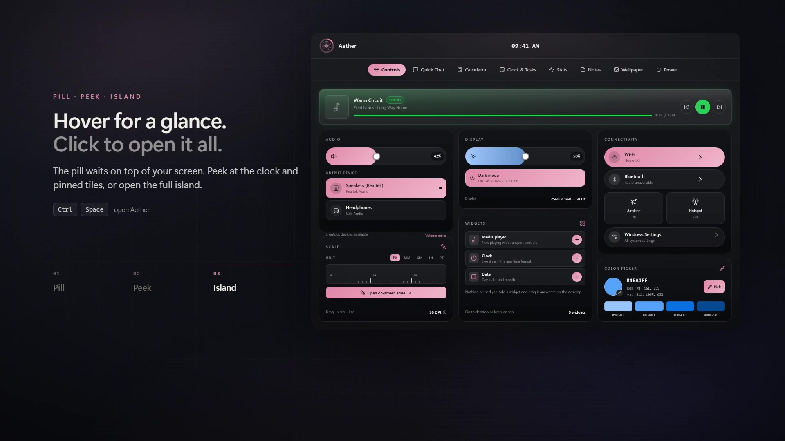

# Aether

> Ultra-low-latency, local-first Windows AI Desktop Assistant & File Utility Overlay.

Aether combines a voice-driven Windows desktop assistant with a zero-friction `Drag + Shift` radial file converter and a top-anchored "Desktop Island" overlay.

<p align="center">
  <a href="docs/media/brag-full.mp4" title="Watch the 40-second Aether tour">
    
  </a>
</p>

https://github.com/user-attachments/assets/94866339-9265-4268-a054-bb0e3135b9b5
<p align="center">
  <sub>▶ <a href="docs/media/brag-full.mp4">Watch the 40-second tour</a> — the Island, Quick Chat and the Drag + Shift file wheel, rendered from the app's own React components rather than a mock-up.<br />
  Music: “Happy Beats Business Moves Vol. 11” by <a href="https://ende.app">Sascha Ende</a> (ende.app), CC BY 4.0.</sub>
</p>

<p align="center">
  <a href="https://github.com/Arthur-101/aether/releases/latest"></a>
  <a href="LICENSE"></a>
  <!-- <a href="https://buymeacoffee.com/Arthur101"></a> -->
</p>


<!--
  Optional inline player.
  GitHub strips <video> tags from repository pages, so a committed MP4 cannot play
  in place — the poster above links to GitHub's own player instead. For true inline
  playback: open README.md in the github.com editor, drag docs/media/brag-full.mp4
  into it, and GitHub inserts a user-attachments URL. Then replace the poster block
  with:

  <p align="center">
    <video src="https://github.com/user-attachments/assets/PASTE-ID-HERE.mp4" controls muted loop width="880"></video>
  </p>
-->

---

## Architecture Highlights

* **Frontend:** Tauri v2 (Rust backend + React 18 + TypeScript + Tailwind CSS + Framer Motion) always-on-top transparent overlay (< 40MB RAM).
* **Backend:** Python 3.12 async daemon (FastAPI + WebSockets + FastMCP).
* **Local LLM:** Optional engine packs drive the bundled `llama-server.exe` from the PrismML
  `llama.cpp` fork — Vulkan by default, and never the CPU. The suggested
  `Ternary-Bonsai-2-9B-PQ2_0-MTP-Q8_0.gguf` needs that fork's ternary `PQ2_0` (ggml type 142)
  support. Nothing is bundled: install an engine pack, then point Settings at a `.gguf`.
* **Memory & Context Pipeline:** Provider-aware memory depth (local default 2 recent turns + 3
  semantic matches; cloud 8 + 8) plus session-scoped vector search via `sqlite-vec` & CPU
  `fastembed` (`bge-small-en-v1.5`, 384 dims, 0 VRAM).
* **Voice Stack:** Local `Phonon-2` STT + 24kHz ONNX TTS (Kokoro/Paradee families) with voices discovered from the model's sidecar.
* **Deterministic Tooling:** Typed FastMCP tools for image/document conversions, metadata stripping (`piexif`), and APScheduler reverse-trigger loops.
* **Zero Hardcoded Paths:** Dynamically resolves `%APPDATA%/Aether` and user-configurable paths via `config_manager.py`.

---

## Directory Structure

```text
aether/
├── bin/                          # Portable binaries (ffmpeg.exe; engine packs add llama-server.exe)
├── backend/
│   ├── config_manager.py         # Portable config manager (%APPDATA%/Aether/config.json)
│   ├── requirements.txt          # Python dependencies
│   ├── test_phase1.py            # Phase 1 verification test
│   ├── db/
│   │   ├── database.py           # SQLite + sqlite-vec setup & tables
│   │   └── sessions.py           # Provider-aware recent window & session-scoped vector memory
│   ├── ai/
│   │   ├── embedder.py           # CPU fastembed (bge-small-en-v1.5)
│   │   ├── llm_router.py         # Local llama-server / Ollama / cloud router
│   │   ├── stt_engine.py         # Phonon-2 STT engine
│   │   ├── tts_engine.py         # Family-detected local ONNX TTS engine
│   │   └── local_voices.py       # Voice-sidecar discovery + phoneme tokenization
│   ├── mcp_tools/                # FastMCP deterministic tools & APScheduler
│   └── os_hooks/                 # Windows OS hooks (pynput, win32com, pywinauto, winsdk)
└── frontend/                     # Tauri v2 + React overlays (DesktopIsland, RadialWheel, Drawer)
```

---

## Setup & Verification

```bash
# 1. Install backend dependencies (Python 3.12 recommended)
cd backend
pip install -r requirements.txt

# 2. Install the isolated Phonon-2 speech-to-text runtime
cd ..
powershell -ExecutionPolicy Bypass -File setup_stt.ps1

# 3. Run the full backend suite
py -3.12 -m pytest backend -q

# 4. Build the frozen daemon (PyInstaller onedir, Python 3.12)
powershell -ExecutionPolicy Bypass -File build_sidecar.ps1

# 5. Build the production overlay and installers
cd frontend
npm run tauri build
```

The build writes `Aether_<version>_x64-setup.exe` (currently `0.1.5`) under
`frontend/src-tauri/target/release/bundle/nsis/`. v1.0 ships NSIS only; the WiX MSI was
built and verified during 0.9 but is not part of the release target. The installer carries
the overlay plus the frozen daemon at `aether-backend\`; the isolated STT runtime remains
an optional `stt-phonon2` pack (see `PACKAGING_AND_CONFIG.md`). Building the sidecar needs
**PyInstaller >= 6.22** — 6.12 cannot freeze numpy 2.5.

Phonon-2 runs in an isolated Python runtime — the optional `stt-phonon2` pack, or a dev
checkout's `bin/stt-runtime` — so Torch and Transformers never load in the backend process.
Without it, dictation stays disabled and logs one actionable warning; the rest of Aether is
unaffected. Install it from Settings → **Components**, or point Settings → Voice → STT Model at
a directory containing `model.fermion` and `config.json`.

Existing configs are upgraded in place with any newly added defaults. An
unreadable `config.json` is preserved as `config.corrupt-<timestamp>.json`
before Aether restores safe defaults.

Aether keeps rotating diagnostics under `%LOCALAPPDATA%\Aether\Logs`:
`aether-backend.log` (written by `backend/logging_setup.py`) and
`aether-overlay.log` (written by the Tauri overlay). Launching Aether twice
focuses the running overlay instead of starting a second one.

---
<!--
## Support

Aether is free and open source, with no paid tier, no ads and no telemetry. If it
earns a place on your machine, you can buy me a coffee:

<p align="center">
  <a href="https://buymeacoffee.com/Arthur101">
    
  </a>
</p>

---
-->

## Licence

Aether is free and open source under the [Apache License, Version 2.0](LICENSE).
You may use, modify, and redistribute it, including commercially, provided you
keep the copyright and licence notices.

Third-party components keep their own licences — `pynput` is LGPL-3.0, `certifi` and
`tqdm` are MPL-2.0 — and every one of them is listed with its licence text in
[`THIRD_PARTY_LICENSES.txt`](THIRD_PARTY_LICENSES.txt). See [`NOTICE`](NOTICE) for the
attribution summary.

Optional downloads are separate works with their own terms: the espeak-ng voice pack is
GPL-3.0-or-later, the ffmpeg media pack is LGPL-3.0-or-later, and model files (LLM, STT,
TTS voices) carry the licence of the model you choose.
